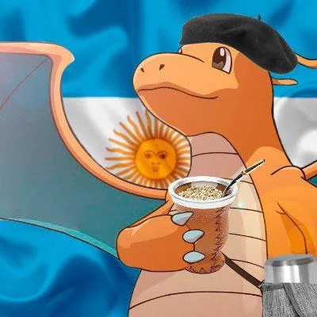

<h1 align="center">🌎 Pokémon Pokopia — Español (Latinoamérica)</h1>

<p align="center">
  
  
  
</p>

<p align="center"><i>Adiós, "¡Qué guay!". Hola, "¡Qué genial!".</i></p>

## 📖 Sobre el proyecto

Adaptación **comunitaria, colaborativa y no oficial** de **Pokémon Pokopia**
al **español latinoamericano**.

El mod no reemplaza ningún idioma: **agrega un décimo botón** en la pantalla
de idiomas. El español de España queda intacto, y tú eliges cuál usar.

La base es el texto de España, adaptado con ayuda de inteligencia artificial
y con revisión humana. Para el estilo se tomó como guía la localización
latinoamericana oficial de *Pokémon Legends: Z-A*. El objetivo es un
**español neutro**, como el de los doblajes: sin voseo, sin "vosotros" y sin
modismos de un solo país.

Es colaborativo de verdad: **cualquiera puede cambiar un texto, compilarlo y
probarlo en su propio juego**. Y si el cambio le sirve a todos, se suma acá.
Más detalles en [Colaborar](#-colaborar).

## ✨ Qué cambia

| España 🇪🇸 | Latinoamérica 🌎 |
|---|---|
| ¡Te he traído algo guay! | ¡Te traje algo genial! |
| Un regalito, ¡a ver si te mola! | Un regalito, ¡a ver si te gusta! |
| ¡Venga, va! | ¡Bueno, vamos! |
| Pulsa el botón que quieras asignar. | Presiona el botón que quieras asignar. |
| casita Poké Ball | casita Pokébola |
| móvil | celular |

| Contenido | Cantidad |
|---|---:|
| Textos adaptados | **11 079** entradas (9 968 textos distintos) |
| Tablas de texto con cambios | **237** |
| Imágenes adaptadas | **1** (el botón del idioma) |

El resto del texto ya era neutro y se muestra igual que en España.

## 📦 Descarga

Descarga **`pokopia-es-latam.zip`** desde **[Releases](../../releases/latest)**.

Qué trae el zip:

```text
pokopia-es-latam.zip
├── LEEME.txt                       instrucciones cortas
├── exefs/
│   └── subsdk9                     el código del mod: va al lado del "main" de tu juego
└── 0400A3A01EE4C000/
    └── ES-LATAM/                   el mod en sí: va en la carpeta "load" de Eglantine
        ├── exefs/
        │   └── 76A489F3BD3642FA5E18BD83D32C98BACC5F7D0E.ips
        └── romfs/
            ├── LINKDATA_PATCH.IDX  textos
            ├── LINKDATA_PATCH.BIN  textos
            └── motor_asset_re/     imágenes
```

## 🎮 Instalación (Eglantine)

### Qué necesitas

- **Eglantine**, el fork de Eden para juegos de Switch 2.
- **Tu propia copia** de Pokémon Pokopia **actualizada a la 2.0.1** (update
  `655360`), extraída en carpetas: `exefs\` y `romfs\`, una al lado de la
  otra.

### Pasos

1. **Cierra el juego.**
2. Copia `exefs\subsdk9` del zip dentro de la carpeta `exefs\` de tu juego,
   **al lado del archivo `main`**.
3. Copia la carpeta `0400A3A01EE4C000` del zip dentro de
   `%APPDATA%\eden\load\`. Tiene que quedar así:

   ```text
   %APPDATA%\eden\load\0400A3A01EE4C000\ES-LATAM\exefs\
   %APPDATA%\eden\load\0400A3A01EE4C000\ES-LATAM\romfs\
   ```

4. En Eglantine, abre el juego desde `exefs\main` (**Archivo → Cargar
   archivo...** o desde la lista de juegos).
5. En la pantalla de idiomas, elige el **décimo botón** (abajo a la derecha)
   y confirma. ¡Bienvenido a Pokopia! 🎉

> **¿Por qué dos partes?** `ES-LATAM` trae los textos, las imágenes y un
> pequeño parche. `subsdk9` es el código que agrega el idioma nuevo.
> Eglantine solo lo carga si está al lado de `main`, así que **siempre van
> juntos**.

### ¿Algo no funciona?

| Problema | Por qué pasa |
|---|---|
| El juego se cierra al arrancar | Falta el `subsdk9` al lado de `main`. |
| No aparece el décimo botón | Tu juego no es la 2.0.1, o `ES-LATAM` no está en la carpeta correcta. |
| No aparece la pantalla de idiomas | Solo sale al empezar una partida nueva. Si ya tienes partida guardada, no se muestra. |
| No puedo cambiar al español latino desde las opciones | Todavía no se puede: por ahora solo se elige en la pantalla del principio. |

### Desinstalar

Borra la carpeta `ES-LATAM`. El `subsdk9` puede quedarse: sin el mod no hace
nada y el juego funciona normal.

## 🤝 Colaborar

¿Un texto te suena raro? ¿Un personaje dice algo que nadie diría? Hay más de
30 000 textos, así que seguro se escapó algún "vale" por ahí. Hay dos formas
de ayudar.

### 1. Avisar

Abre un **[Issue](../../issues)** con:

- el texto tal como aparece (una captura ayuda muchísimo 📸),
- dónde lo viste (diálogo, menú, nombre de un objeto...),
- cómo lo dirías tú.

### 2. Cambiarlo tú mismo

Así puedes cambiar el texto a tu gusto, probarlo en tu juego y, si quieres,
compartirlo:

1. Haz un **fork** de este repo y clónalo.
2. Edita el texto (ver abajo).
3. Compila y pruébalo en tu juego (ver *Compilar y probar*, más abajo).
4. ¿Te gustó cómo quedó? Abre un **Pull Request**. 🚀

### Cómo se edita el texto

Todo el texto vive en `text/es-419/table_<número>.po`. Cada entrada se ve
así:

```po
#. en: Press the button you want to assign.
msgctxt "4614:486"
msgid "Pulsa el botón que quieras asignar."
msgstr "Presiona el botón que quieras asignar."
```

| Campo | Qué es |
|---|---|
| `#. en:` | El texto en inglés, para entender el contexto. |
| `msgctxt` | Dónde está el texto (tabla y fila). No lo cambies. |
| `msgid` | El texto de España. **No lo cambies.** |
| `msgstr` | **La versión latinoamericana.** Si está vacío, el juego usa el de España. |

Para encontrar un texto, busca una frase en la carpeta `text/es-419/` (en VS
Code: `Ctrl+Shift+F`). Puedes editar con cualquier editor de texto o con
[Poedit](https://poedit.net/).

#### Las reglas de oro

1. **Copia cada etiqueta `<...>` tal cual.** `<br>` es un salto de línea,
   `<pname;0>` es un nombre y `<$cdef(27)>...</color>` es texto de color.
   No cambies la cantidad ni el orden de `<br>`, `<clear>` y `<slide>`.
2. **Español neutro.** "Tú" para una persona y "ustedes" para varias. Nada de
   "vos", "vosotros", "chido", "bacán" ni "che".
3. **Términos oficiales de Pokémon.** Pokébola, Pelea, Insecto, presionar...
4. **Cambia solo lo necesario.** Respeta el tono, los chistes y la forma de
   hablar de cada personaje.

No te preocupes si rompes algo: el compilador revisa las etiquetas y te dice
qué entrada tiene un problema.

### 🛠️ Compilar y probar

**Requisitos**

- Python 3.10 o más nuevo, con `pip install numpy pillow`.
- LLVM (`clang`, `ld.lld`, `llvm-nm`): en `C:\Program Files\LLVM\bin`, en el
  `PATH` o en la variable `LLVM_BIN`.
- Tu copia del juego (2.0.1), extraída en carpetas.

**Una sola vez**, conecta tu juego con el repo creando la carpeta `boot\` (no
se sube a GitHub):

```bat
mkdir boot\exefs
copy <tu-juego>\exefs\* boot\exefs\
mklink /J boot\romfs <tu-juego>\romfs
```

**Cada vez que quieras probar** algo, cierra el emulador y ejecuta:

```bat
python scripts/build_all.py
```

Esto compila las imágenes, el texto y el código, revisa que todo esté bien y
lo instala: `ES-LATAM` en `%APPDATA%\eden\load\0400A3A01EE4C000\` y
`subsdk9` en `boot\exefs\`. Después abre **`boot\exefs\main`** en Eglantine y
juega con tus cambios.

| Comando | Qué hace |
|---|---|
| `python scripts/build_all.py` | Compila e instala para probar |
| `python scripts/build_all.py --no-install` | Solo compila y verifica |
| `python scripts/build_all.py --package` | Arma `dist/pokopia-es-latam.zip` para publicar |
| `python scripts/reset_save.py` | Borra tu partida (con confirmación) para volver a ver la pantalla de idiomas |
| `python tests/run_tests.py` | Corre los tests |

### 🖼️ Imágenes con texto

Algunos textos están dibujados en imágenes: tutoriales, carteles, el logo y
el botón del idioma. La primera compilación extrae los originales de tu
juego a `assets/reference/` (esa carpeta tampoco se sube). Para adaptar una:

1. Copia la imagen de `assets/reference/es-ES/` a `assets/es-419/`, con el
   mismo nombre.
2. Edítala **sin cambiar el tamaño** y conservando la transparencia.
3. Compila. Solo se empaquetan las imágenes que cambiaron.

Todas las reglas están en [`assets/README.md`](assets/README.md).

### 🔬 Para curiosos

- [`docs/README.md`](docs/README.md): cómo funciona el mod por dentro.
- [`docs/RE-FINDINGS.md`](docs/RE-FINDINGS.md): la ingeniería inversa del
  juego.
- [`docs/ASSETS-FORMAT.md`](docs/ASSETS-FORMAT.md): los formatos de imagen.
- [`tools/README.md`](tools/README.md): las herramientas de texto, incluida
  una revisión asistida con un modelo local (Ollama).

## 💛 Créditos

- **Adaptación y mod:** [TakeItSlow](https://github.com/Takeitslowww).
- **Referencia de estilo:** el texto latinoamericano oficial de *Pokémon
  Legends: Z-A*, recopilado en
  [CPokemon/plza-text](https://github.com/CPokemon/plza-text).
- **Inspiración:** la [traducción PT-BR](https://github.com/LucianoNeo/pokemon-pokopia-pt-br)
  de LucianoNeo.
- **Emulador:** Eglantine, fork de Eden por Franseven.
- **Y tú**, si mandas un Issue o un Pull Request. 🙌

## ⚖️ Aviso legal

Proyecto hecho por fans, sin fines de lucro y sin relación con Nintendo, The
Pokémon Company, Game Freak ni Creatures. Pokémon y Pokémon Pokopia son
marcas de sus respectivos dueños.

Este repositorio **no incluye el juego ni sus archivos** (ejecutables, romfs
o imágenes originales). Solo trae los archivos de traducción, las imágenes
editadas y las herramientas para compilarlos con **tu propia copia legal**.

---

<p align="center">
  
</p>

<p align="center"><sub>
  Sí, el autor es argentino 🧉. No, la traducción no lo es: es neutra, más
  cerca de lo mexicano, hecha por y para latinoamericanos.<br>
  El Dragonite es solo un meme.
</sub></p>
